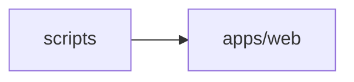

# Architecture

Gym Shop consists of a Next.js storefront and developer tooling. The storefront serves shopping, account, and support-chat experiences, while the scripts module provides API smoke testing and a mock Anthropic streaming server for chatbot development. The chatbot is an AI touchpoint in both the storefront and its supporting test tooling; the backend provider and tool-execution implementation are not specified.

## Modules

| module | summary | AI |
| --- | --- | --- |
| `apps/web` | Next.js storefront with catalog, cart, accounts, API proxying, and an SSE-based AI support chat widget. | [AI] |
| `scripts` | Developer CLI tooling for backend smoke tests and a mock Anthropic Messages API server with streaming and tool-call support. | [AI] |

## Module dependencies

_`[AI]` marks modules with AI/LLM touchpoints (prompt files, model API calls, agent logic)._
